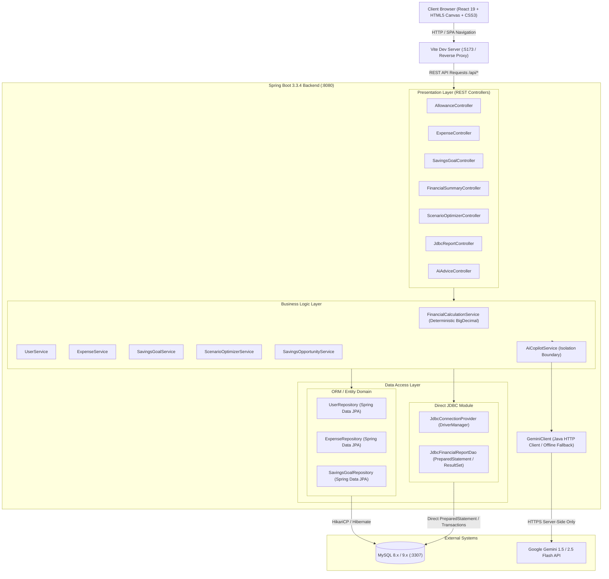
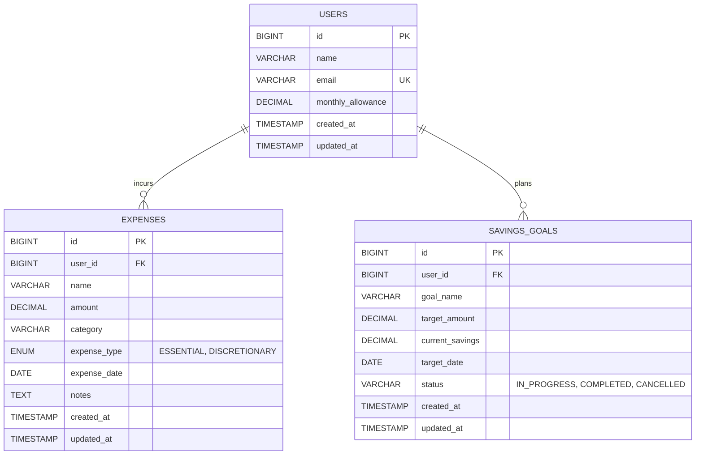

# Architecture Specification: Student Financial Copilot

## 1. System Overview

**Student Financial Copilot** is a high-reliability, full-stack personal finance and AI-assisted budgeting platform engineered specifically for university students managing a fixed monthly allowance. The system resolves the core student question:

> *"Can I afford this goal, and what exact budget changes should I make to achieve it?"*

The architecture implements a **clean three-tier modular monolith** with strict separation of concerns, deterministic mathematical guarantees using Java `BigDecimal`, dual data-access paradigms (Spring Data JPA + Direct JDBC), and an isolated Google Gemini AI integration that operates strictly on verified calculation snapshots.



---

## 2. Architectural Principles & Design Decisions

### 2.1 Deterministic Calculation Foundation
AI language models can hallucinate or make arithmetic errors when computing compound finances. Therefore, the architecture enforces a strict invariant:
- **All financial arithmetic, savings rates, deficit detections, remaining months, and feasibility formulas are calculated strictly within the deterministic Java service layer ([FinancialCalculationService.java](file:///Users/arnabhazra/student-financial-copilot-2/backend/src/main/java/com/copilot/service/FinancialCalculationService.java)) using `java.math.BigDecimal` with `RoundingMode.HALF_UP`.**
- The AI Copilot receives a verified immutable data snapshot of these precomputed figures. The LLM acts solely as a natural language synthesizer and strategic financial mentor—never as an authoritative calculator.

### 2.2 Dual Persistence Paradigms: JPA vs. Direct JDBC
To demonstrate both modern enterprise ORM patterns and fundamental database connectivity required by university syllabi:
1. **Spring Data JPA (`com.copilot.repository`):** Used for standard entity lifecycle and CRUD operations (`User`, `Expense`, `SavingsGoal`). Leverages Hibernate 6 for automatic DDL validation, connection pooling via HikariCP, and object-relational mapping.
2. **Direct JDBC Module (`com.copilot.jdbc`):** An independent, dedicated data access module using low-level JDBC components:
   - `DriverManager.getConnection()` for direct handshake.
   - `Connection` interface with manual transaction boundaries (`setAutoCommit(false)`, `commit()`, `rollback()`).
   - `PreparedStatement` with parameterized placeholders (`?`) to prevent SQL injection.
   - `ResultSet` cursor iteration and resource cleanup using `try-with-resources`.
   - Used in production for generating high-performance monthly aggregate financial reports and simulating atomic multi-table transactions.

### 2.3 Microservice Readability & Future Extraction
The AI Copilot module is isolated within `com.copilot.ai`. The service interface accepts an explicit `FinancialSummaryResponse` DTO and a user prompt. If the system scales into microservices:
- `com.copilot.ai` can be lifted directly into a standalone Spring Boot microservice.
- The monolithic `AiAdviceController` can simply become an HTTP client proxy calling the microservice via Spring `RestClient`.
- No database tables or entity relationships leak into the AI layer.

---

## 3. Database Architecture & Schema Design

The schema is 3NF normalized, hosted in MySQL on dedicated port `3307`:



### Table Specifications:
1. **`users`**:
   - `monthly_allowance`: `DECIMAL(12, 2)` representing fixed monthly financial support.
   - `email`: `VARCHAR(150)` with a unique constraint.
2. **`expenses`**:
   - `expense_type`: `ENUM('ESSENTIAL', 'DISCRETIONARY')` differentiating non-negotiable living costs (rent, food, medicine) from flexible expenses (entertainment, dining out, shopping).
   - Indexed on `(user_id, expense_date)` and `(user_id, category)` for fast aggregation and range queries.
3. **`savings_goals`**:
   - `target_amount` and `current_savings`: `DECIMAL(12, 2)`.
   - `target_date`: `DATE` used to compute remaining months and required monthly savings rate.

---

## 4. Frontend Architecture

The frontend is built with React 19 and Vite, following a modular component hierarchy styled using custom CSS3 design tokens with dark/light theme switching.

### 4.1 Component Hierarchy
```
AppLayout
├── Navbar (User status, quick metrics, theme toggle, mobile drawer toggle)
├── Sidebar (Navigation routes: Dashboard, Expenses, Goals, Optimizer, AI Copilot, Reports)
└── Page Routing (React Router v7)
    ├── DashboardPage
    │   ├── SummaryCards (Allowance, Expenses, Net Savings, Savings Rate)
    │   ├── CanvasGauge (HTML5 Canvas 2D radial savings meter)
    │   ├── BudgetOverview (Progress bar breakdown of Essential vs Discretionary)
    │   ├── SpendingDistributionChart (Category expenditure bars)
    │   └── GoalsProgressList (Snapshot cards of active goals)
    ├── ExpensesPage
    │   ├── ExpenseFilters (Search, category filter, date ranges, sorting)
    │   ├── ExpenseTable (Responsive table with classification badges & actions)
    │   └── ExpenseForm (Modal form with client & server-side validation)
    ├── GoalsPage
    │   ├── GoalCard (Progress bar, remaining funds, feasibility warnings)
    │   ├── GoalFormModal (Create / edit goal details)
    │   └── GoalDepositModal (Add funds to an active goal)
    ├── OptimizerPage
    │   ├── ScenarioSlider (Simulate discretionary reduction & allowance adjustments)
    │   ├── ComparisonCard (Side-by-side comparison of baseline vs simulated budget)
    │   └── OpportunitiesList (Deterministic suggestions for expense cuts)
    ├── AiCopilotPage
    │   └── AiChatPanel (Interactive chat with suggested prompts, Markdown rendering, copy button)
    └── ReportsPage
        ├── JdbcReportSummary (Monthly aggregates computed directly via PreparedStatement)
        └── JdbcTransactionDemo (Live demonstration of JDBC commit/rollback atomicity)
```

### 4.2 State Management & Custom Hooks
State is centralized via `FinancialContext` using React's `useContext` and specialized hooks:
- **`useFinancialSummary`**: Fetches and computes active financial metrics, deficits, and category maps.
- **`useExpenses`**: Handles expense CRUD, optimistic UI filtering, search debouncing, and sorting.
- **`useGoals`**: Manages goal lifecycle, deposits, and real-time feasibility recalculations.
- **`useDebugValue`**: Embedded inside custom hooks to inspect financial state in React DevTools.

---

## 5. Security & Reliability

1. **API Key Security**: The Gemini API key is read strictly from the `GEMINI_API_KEY` environment variable in Spring Boot. It is never transmitted to the frontend bundle.
2. **Offline Fallback Resilience**: If the Gemini API is unreachable, times out, or no API key is provided, the backend falls back gracefully to an intelligent rule-based expert recommendation engine without throwing 500 errors to the client.
3. **SQL Injection Immunity**:
   - JPA uses parameterized Hibernate queries.
   - Direct JDBC exclusively uses `PreparedStatement` with typed set methods (`setLong`, `setString`, `setDate`). No SQL strings are concatenated with user input.
4. **Input Validation**: Hibernate Validator validates incoming DTOs (`@NotBlank`, `@Positive`, `@NotNull`, `@Size`). Global exception handler returns structured RFC 7807 compliant error payloads.
